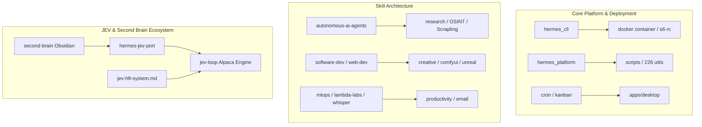

# Master Knowledge & Capability Index: Hermes Agent, Skills, Platform & JEV Ecosystem

> Comprehensive reference catalog indexing 36 discrete subsystems, core references, execution runtimes, optional skills, and trading scaffolds across the Hermes Agent and JEV Second Brain repositories.

## Executive Taxonomy & Architectural Overview



---

## Quick Reference Table of Indexed Targets

| # | Domain | Target | Type | Scale / Metric | Primary Purpose |
|---|---|---|---|---|---|
| 1 | MLOps & Cloud Infrastructure | [Lambda Labs Advanced Usage Reference](file:///C:/Users/alesh/AppData/Local/hermes/hermes-agent/optional-skills/mlops/lambda-labs/references/advanced-usage.md) | File | 611 lines (14 KB) | Production guide for multi-node distributed PyTorch training (DDP), Ray clusters, vLLM / S... |
| 2 | Software Development & CI/CD | [GitHub Authentication & Access Setup](file:///C:/Users/alesh/AppData/Local/hermes/hermes-agent/skills/software-development/github/references/auth.md) | File | 303 lines (11 KB) | Standard operating procedure for agent authentication against GitHub. Details detection ca... |
| 3 | Creative, Gaming & 3D Simulation | [Unreal Engine 5.8 MCP Advanced Workflows](file:///C:/Users/alesh/AppData/Local/hermes/hermes-agent/optional-skills/creative/unreal-mcp/references/advanced-workflows.md) | File | 256 lines (12 KB) | Live-verified integration protocols for Unreal Engine 5.8 via Model Context Protocol (MCP)... |
| 4 | Platform Core & Extensions | [Hermes Built-in Plugins Architecture](file:///C:/Users/alesh/AppData/Local/hermes/hermes-agent/website/docs/user-guide/features/built-in-plugins.md) | File | 323 lines (20 KB) | Technical architecture and user documentation for Hermes Agent's built-in plugin engine. D... |
| 5 | Autonomous AI Agents | [Hermes Agent Bundled Core Skill](file:///C:/Users/alesh/AppData/Local/hermes/hermes-agent/website/docs/user-guide/skills/bundled/autonomous-ai-agents/autonomous-ai-agents-hermes-agent.md) | File | 230 lines (13 KB) | Reference manual for the bundled Hermes Agent skill. Defines how Hermes inspects its own c... |
| 6 | Autonomous AI Agents | [Dynamic Workflow Skill](file:///C:/Users/alesh/AppData/Local/hermes/hermes-agent/website/docs/user-guide/skills/optional/autonomous-ai-agents/autonomous-ai-agents-dynamic-workflow.md) | File | 198 lines (11 KB) | Advanced multi-agent orchestration skill enabling plan-in-code fan-outs, adversarial verif... |
| 7 | Autonomous AI Agents | [Blackbox AI Multi-Model Coding CLI](file:///C:/Users/alesh/AppData/Local/hermes/hermes-agent/website/docs/user-guide/skills/optional/autonomous-ai-agents/autonomous-ai-agents-blackbox.md) | File | 161 lines (6 KB) | Interface guide for delegating code generation, review, and refactoring to the Blackbox AI... |
| 8 | Creative Media & Visual Simulation | [ASCII Video Creative Engine Architecture](file:///C:/Users/alesh/AppData/Local/hermes/hermes-agent/skills/creative/ascii-video/references/architecture.md) | File | 802 lines (32 KB) | 802-line deep architectural specification for Hermes' ASCII video and text-mode graphics e... |
| 9 | Automation & DevOps | [Hermes Automation Blueprints](file:///C:/Users/alesh/AppData/Local/hermes/hermes-agent/website/docs/guides/automation-blueprints.md) | File | 595 lines (19 KB) | Production blueprints for autonomous agent workflows including nightly GitHub backlog tria... |
| 10 | Automation & Scheduling | [Automate with Cron Architecture & Patterns](file:///C:/Users/alesh/AppData/Local/hermes/hermes-agent/website/docs/guides/automate-with-cron.md) | File | 292 lines (12 KB) | End-to-end guide on configuring scheduled autonomous agent jobs via Hermes Cron. Documents... |
| 11 | Testing & Quality Assurance | [Hermes Test Engineering Guidelines](file:///C:/Users/alesh/AppData/Local/hermes/hermes-agent/tests/AGENTS.md) | File | 154 lines (9 KB) | Strict architectural rules for the Hermes Agent test suite (`tests/`). Enforces rules agai... |
| 12 | Productivity & Operations | [Productivity Skills Suite](file:///C:/Users/alesh/AppData/Local/hermes/hermes-agent/optional-skills/productivity) | Directory | 20 files (10 skills) | Collection of 10 operational skills spanning Canvas LMS academic tracking, interactive dec... |
| 13 | Research & OSINT | [Domain Intelligence & Reconnaissance Skill](file:///C:/Users/alesh/AppData/Local/hermes/hermes-agent/optional-skills/research/domain-intel) | Directory | 2 files (1 skills) | Passive reconnaissance and cybersecurity intelligence skill. Gathers subdomains, SSL certi... |
| 14 | Research & Web Scraping | [Scrapling Stealth Web Scraper Skill](file:///C:/Users/alesh/AppData/Local/hermes/hermes-agent/optional-skills/research/scrapling) | Directory | 1 files (1 skills) | Undetectable web extraction engine equipped with fingerprint spoofing, Cloudflare Turnstil... |
| 15 | Software Engineering | [Software Development & Refactoring Skills](file:///C:/Users/alesh/AppData/Local/hermes/hermes-agent/optional-skills/software-development) | Directory | 29 files (6 skills) | Suite of 6 core development skills: structural code search (`ast-grep`), automated codebas... |
| 16 | Web Engineering | [Web Development & Frontend Deployment Skills](file:///C:/Users/alesh/AppData/Local/hermes/hermes-agent/optional-skills/web-development) | Directory | 31 files (5 skills) | Suite of 5 web engineering skills: instant zero-config Cloudflare Worker deploys (`cloudfl... |
| 17 | Developer Tooling & DevOps | [Hermes Core Engineering Scripts Repository](file:///C:/Users/alesh/AppData/Local/hermes/hermes-agent/scripts) | Directory | 226 files (0 skills) | 226 production automation and validation scripts powering Hermes Agent. Includes MSIX bund... |
| 18 | Research, OSINT & Scientific Computing | [Research & Intelligence Gathering Skills](file:///C:/Users/alesh/AppData/Local/hermes/hermes-agent/optional-skills/research) | Directory | 111 files (15 skills) | 15 advanced research skills spanning bioinformatics (400+ genomics skills), RSS feed monit... |
| 19 | Autonomous AI Agents | [Autonomous AI Agents Orchestration Skills](file:///C:/Users/alesh/AppData/Local/hermes/hermes-agent/optional-skills/autonomous-ai-agents) | Directory | 9 files (7 skills) | Collection of 7 multi-agent skills: neutral git merge conflict arbitration (`agent-merge-c... |
| 20 | Hermes Agent CLI Core | [Hermes CLI Core Architecture & Subsystem](file:///C:/Users/alesh/AppData/Local/hermes/hermes-agent/hermes_cli) | Directory | 1292 files (0 skills) | 1,292 files comprising the complete Hermes CLI implementation. Features the central REPL l... |
| 21 | Containerization & Sandboxing | [Hermes Docker & s6-rc Supervision System](file:///C:/Users/alesh/AppData/Local/hermes/hermes-agent/docker) | Directory | 21 files (0 skills) | Containerization architecture for Hermes Agent. Utilizes s6-rc process supervision, multi-... |
| 22 | Desktop Application Architecture | [Hermes Desktop Application Engineering Guide](file:///C:/Users/alesh/AppData/Local/hermes/hermes-agent/apps/desktop/AGENTS.md) | File | 171 lines (9 KB) | Core architectural manifesto for the Hermes Desktop native client. Establishes state autho... |
| 23 | Job Scheduling & Work Orchestration | [Hermes Cron & Kanban Work Queue Engine](file:///C:/Users/alesh/AppData/Local/hermes/hermes-agent/cron/AGENTS.md) | File | 155 lines (12 KB) | Architecture document detailing the Hermes background job scheduler (`cron/`) and durable ... |
| 24 | CLI Architecture & Extensibility | [Hermes CLI & Slash Commands Specification](file:///C:/Users/alesh/AppData/Local/hermes/hermes-agent/hermes_cli/AGENTS.md) | File | 217 lines (17 KB) | Comprehensive specification for CLI internals, slash command registrations (`hermes_cli/co... |
| 25 | Platform & OS Interop | [Hermes Platform Abstraction Layer Specification](file:///C:/Users/alesh/AppData/Local/hermes/hermes-agent/hermes_platform/AGENTS.md) | File | 14 lines (0 KB) | Low-level system information and hardware inspection layer (`hermes_platform/`). Enforces ... |
| 26 | Creative & Architecture Diagramming | [Archify Upstream Diagramming Skill](file:///C:/Users/alesh/AppData/Local/hermes/hermes-agent/optional-skills/creative/archify/SKILL.md) | File | 52 lines (2 KB) | Upstream-maintained skill for generating validated, interactive HTML architectural diagram... |
| 27 | Creative Media & Diffusion | [ComfyUI Generative Workflow Skill Suite](file:///C:/Users/alesh/AppData/Local/hermes/hermes-agent/optional-skills/creative/comfyui) | Directory | 33 files (1 skills) | Complete generative AI production suite for ComfyUI. Includes 33 files featuring automated... |
| 28 | Creative & Diagramming | [Excalidraw Diagram Engine Skill](file:///C:/Users/alesh/AppData/Local/hermes/hermes-agent/optional-skills/creative/excalidraw) | Directory | 5 files (1 skills) | Tooling for programmatic generation of hand-drawn Excalidraw JSON schematics. Features cus... |
| 29 | Creative Media & Video Generation | [Hyperframes Web-to-Video Engine](file:///C:/Users/alesh/AppData/Local/hermes/hermes-agent/optional-skills/creative/hyperframes) | Directory | 8 files (1 skills) | Video production toolkit that converts HTML/CSS and GSAP timeline animations into crisp MP... |
| 30 | Communication & Inboxes | [AgentMail Autonomous Email Inboxes Skill](file:///C:/Users/alesh/AppData/Local/hermes/hermes-agent/optional-skills/email) | Directory | 6 files (1 skills) | API and CLI skill enabling agents to provision disposable and permanent email inboxes, sen... |
| 31 | MLOps & Prompt Optimization | [DSPy Declarative LM Programming Skill](file:///C:/Users/alesh/AppData/Local/hermes/hermes-agent/optional-skills/mlops/research) | Directory | 5 files (1 skills) | Integration guide and templates for DSPy. Focuses on programming language models declarati... |
| 32 | MLOps & Audio Processing | [OpenAI Whisper Speech Transcription Skill](file:///C:/Users/alesh/AppData/Local/hermes/hermes-agent/optional-skills/mlops/whisper) | Directory | 2 files (1 skills) | Audio intelligence skill configuring local and cloud OpenAI Whisper transcription and tran... |
| 33 | Core Documentation | [Hermes Agent Root Documentation & Manifesto](file:///C:/Users/alesh/AppData/Local/hermes/hermes-agent/README.md) | File | 243 lines (16 KB) | Main README.md for Hermes Agent by Nous Research. Outlines the self-improving AI agent par... |
| 34 | Second Brain & Knowledge Systems | [Modular Second Brain Obsidian Knowledge Vault](file:///C:/Users/alesh/.codex/.chatgpt-projects/g-p-6ac67b2040f48191b4c6be88b2128bf8/outputs/second-brain) | Directory | 80 files (0 skills) | 80-file modular second brain knowledge vault. Features an Obsidian vault with the Gemini S... |
| 35 | JEV Financial Trading System | [hermes-jev-port Trading Runtime Engine](file:///C:/Users/alesh/.codex/.chatgpt-projects/g-p-6ac67b2040f48191b4c6be88b2128bf8/hermes-jev-port) | Directory | 117 files (0 skills) | 117-file production port of Roan's JEV trading loop for Hermes Agent. Implements a paper-f... |
| 36 | Financial Systems Reference | [JEV High-Frequency Trading System Blueprint](file:///C:/Users/alesh/.codex/.chatgpt-projects/g-p-6ac67b2040f48191b4c6be88b2128bf8/hermes-jev-port/references) | Directory | 1 files (0 skills) | 313 KB, 6,626-line master reference manual detailing the architecture, mathematical models... |

---

## Detailed Subsystem & File Specifications

### 1. Lambda Labs Advanced Usage Reference (`advanced-usage.md`)
- **Path:** [C:\Users\alesh\AppData\Local\hermes\hermes-agent\optional-skills\mlops\lambda-labs\references\advanced-usage.md](file:///C:/Users/alesh/AppData/Local/hermes/hermes-agent/optional-skills/mlops/lambda-labs/references/advanced-usage.md)
- **Domain:** `MLOps & Cloud Infrastructure`
- **Type:** `File`
- **Size:** 15,108 bytes (611 lines)
- **Executive Summary:** Production guide for multi-node distributed PyTorch training (DDP), Ray clusters, vLLM / SGLang high-throughput inference hosting, InfiniBand fabric configuration, Slurm scheduling, and persistent storage mounts on Lambda Labs GPU instances.
- **Core Capabilities & Architectural Invariants:**
  - PyTorch DistributedDataParallel (DDP) multi-node setup with torchrun/NCCL
  - Ray cluster launch & autoscaling across Lambda GPU nodes
  - vLLM and SGLang deployment with tensor parallelism and OpenAI-compatible endpoints
  - InfiniBand/RoCE network verification (`ibv_devinfo`, `nccl-tests`)
  - Slurm workload manager configuration and Lambda Cloud filesystem mounts
- **Document Table of Contents:**
  - `# Lambda Labs Advanced Usage Guide`
  - `## Multi-Node Distributed Training`
  - `### PyTorch DDP across nodes`
  - `# train_multi_node.py`
  - `# Environment variables set by launcher`
  - `# Training loop with synchronized gradients`
  - `# Save checkpoint on rank 0 only`
  - `### Launch on multiple instances`

### 2. GitHub Authentication & Access Setup (`auth.md`)
- **Path:** [C:\Users\alesh\AppData\Local\hermes\hermes-agent\skills\software-development\github\references\auth.md](file:///C:/Users/alesh/AppData/Local/hermes/hermes-agent/skills/software-development/github/references/auth.md)
- **Domain:** `Software Development & CI/CD`
- **Type:** `File`
- **Size:** 11,586 bytes (303 lines)
- **Executive Summary:** Standard operating procedure for agent authentication against GitHub. Details detection cascades, HTTPS credential caching, Fine-Grained Personal Access Tokens (PATs), SSH key provisioning (`id_ed25519`), and the GitHub CLI (`gh auth login`) non-interactive flows.
- **Core Capabilities & Architectural Invariants:**
  - Detection flow: auto-discovering existing git credentials, tokens, or gh CLI state
  - Non-interactive PAT authentication using git credential-store helper
  - SSH key generation with ed25519 and automated GitHub public key installation
  - GitHub CLI token integration for PR creation, review, and issue tracking
  - Automated fallback strategies for restricted or non-root terminal environments
- **Document Table of Contents:**
  - `# GitHub Authentication Setup`
  - `## Detection Flow`
  - `# Check what's available`
  - `# Check if already authenticated`
  - `## Method 1: Git-Only Authentication (No gh, No sudo)`
  - `### Option A: HTTPS with Personal Access Token (Recommended)`
  - `# Set up the credential helper to cache credentials`
  - `# "store" saves to ~/.git-credentials in plaintext (simple, persistent)`

### 3. Unreal Engine 5.8 MCP Advanced Workflows (`advanced-workflows.md`)
- **Path:** [C:\Users\alesh\AppData\Local\hermes\hermes-agent\optional-skills\creative\unreal-mcp\references\advanced-workflows.md](file:///C:/Users/alesh/AppData/Local/hermes/hermes-agent/optional-skills/creative/unreal-mcp/references/advanced-workflows.md)
- **Domain:** `Creative, Gaming & 3D Simulation`
- **Type:** `File`
- **Size:** 13,003 bytes (256 lines)
- **Executive Summary:** Live-verified integration protocols for Unreal Engine 5.8 via Model Context Protocol (MCP). Covers ProgrammaticToolset serial batching, Blueprint authoring with Domain-Specific Languages (DSL), dynamic schema error discovery, and automated asset manipulation.
- **Core Capabilities & Architectural Invariants:**
  - ProgrammaticToolset batching without violating UE editor serial execution rules
  - Blueprint authoring loop using declarative JSON DSL to compile nodes and pins
  - Schema-in-error discovery mechanism for inspecting dynamic reflection properties
  - Live viewport synchronization, camera control, and lighting adjustments
  - Material graph generation and level actor spawning via remote JSON-RPC
- **Document Table of Contents:**
  - `# Advanced workflows (live-verified on UE 5.8)`
  - `## ProgrammaticToolset — batching without breaking the serial rule`
  - `## Blueprint authoring — the DSL loop`
  - `## Schema-in-error is a first-class discovery mechanism`
  - `## PIE sessions (schema-verified)`
  - `## Sequencer — orientation for a 140-tool surface`
  - `## Editor self-debugging with LogsToolset`
  - `## Automation testing`

### 4. Hermes Built-in Plugins Architecture (`built-in-plugins.md`)
- **Path:** [C:\Users\alesh\AppData\Local\hermes\hermes-agent\website\docs\user-guide\features\built-in-plugins.md](file:///C:/Users/alesh/AppData/Local/hermes/hermes-agent/website/docs/user-guide/features/built-in-plugins.md)
- **Domain:** `Platform Core & Extensions`
- **Type:** `File`
- **Size:** 20,509 bytes (323 lines)
- **Executive Summary:** Technical architecture and user documentation for Hermes Agent's built-in plugin engine. Details plugin discovery mechanisms, opt-in lifecycle configurations, sandboxing, hook registration, and integration of core extensions.
- **Core Capabilities & Architectural Invariants:**
  - Discovery hierarchy: root, user directory, and workspace plugin scanners
  - Opt-in configuration via `config.yaml` (`plugins.enabled`)
  - Plugin manifest validation (`plugin.json` schema, dependencies, and permissions)
  - Lifecycle hooks: `on_session_start`, `on_tool_call`, `on_response_complete`
  - Isolation boundaries and security sandbox policies for untrusted extensions
- **Document Table of Contents:**
  - `# Built-in Plugins`
  - `## How discovery works`
  - `## Bundled plugins are opt-in`
  - `# or: remove it from plugins.enabled in config.yaml`
  - `## Currently shipped`
  - `### disk-cleanup`
  - `### security-guidance`
  - `### Langfuse (moved to the plugin catalog)`

### 5. Hermes Agent Bundled Core Skill (`autonomous-ai-agents-hermes-agent.md`)
- **Path:** [C:\Users\alesh\AppData\Local\hermes\hermes-agent\website\docs\user-guide\skills\bundled\autonomous-ai-agents\autonomous-ai-agents-hermes-agent.md](file:///C:/Users/alesh/AppData/Local/hermes/hermes-agent/website/docs/user-guide/skills/bundled/autonomous-ai-agents/autonomous-ai-agents-hermes-agent.md)
- **Domain:** `Autonomous AI Agents`
- **Type:** `File`
- **Size:** 14,042 bytes (230 lines)
- **Executive Summary:** Reference manual for the bundled Hermes Agent skill. Defines how Hermes inspects its own capabilities, manages long-term persona state, configures active model providers, invokes internal slash commands, and orchestrates recursive agent tasks.
- **Core Capabilities & Architectural Invariants:**
  - Self-inspection and capability discovery across skills and tools
  - Long-term memory management across sessions via MEMORY.md and USER.md
  - Model routing and provider switching (Nous, Anthropic, OpenAI, local vLLM)
  - Recursive subagent spawning with scoped working directories and context isolation
  - Dynamic prompt injection and personality theme adaptation
- **Document Table of Contents:**
  - `# Hermes Agent`
  - `## Skill metadata`
  - `## Reference: full SKILL.md`
  - `# Hermes Agent`
  - `## Scope & Verification`
  - `## Quick Start`
  - `# Install (shell installer — bootstraps PM, Python, dependencies, and the launcher)`
  - `# Interactive chat (default surface; set display.interface: tui to launch the Ink TUI instead)`

### 6. Dynamic Workflow Skill (`autonomous-ai-agents-dynamic-workflow.md`)
- **Path:** [C:\Users\alesh\AppData\Local\hermes\hermes-agent\website\docs\user-guide\skills\optional\autonomous-ai-agents\autonomous-ai-agents-dynamic-workflow.md](file:///C:/Users/alesh/AppData/Local/hermes/hermes-agent/website/docs/user-guide/skills/optional/autonomous-ai-agents/autonomous-ai-agents-dynamic-workflow.md)
- **Domain:** `Autonomous AI Agents`
- **Type:** `File`
- **Size:** 11,353 bytes (198 lines)
- **Executive Summary:** Advanced multi-agent orchestration skill enabling plan-in-code fan-outs, adversarial verification waves, and checkpointed multi-stage execution DAGs.
- **Core Capabilities & Architectural Invariants:**
  - Plan-in-code: defining task graphs programmatically in Python/JavaScript
  - Parallel fan-out execution across specialized agent workers
  - Adversarial verification waves where reviewer agents critique generator outputs
  - Durable state checkpointing allowing resumes from failed workflow nodes
  - Dynamic task re-weighting based on intermediate evaluation scores
- **Document Table of Contents:**
  - `# Dynamic Workflow`
  - `## Skill metadata`
  - `## Reference: full SKILL.md`
  - `# Dynamic Workflow Skill`
  - `## When to Use`
  - `## Prerequisites`
  - `## How to Run`
  - `### Background-first: results re-enter as messages`

### 7. Blackbox AI Multi-Model Coding CLI (`autonomous-ai-agents-blackbox.md`)
- **Path:** [C:\Users\alesh\AppData\Local\hermes\hermes-agent\website\docs\user-guide\skills\optional\autonomous-ai-agents\autonomous-ai-agents-blackbox.md](file:///C:/Users/alesh/AppData/Local/hermes/hermes-agent/website/docs/user-guide/skills/optional/autonomous-ai-agents/autonomous-ai-agents-blackbox.md)
- **Domain:** `Autonomous AI Agents`
- **Type:** `File`
- **Size:** 6,470 bytes (161 lines)
- **Executive Summary:** Interface guide for delegating code generation, review, and refactoring to the Blackbox AI CLI suite across diverse foundational models.
- **Core Capabilities & Architectural Invariants:**
  - Subagent task delegation to external Blackbox models
  - Context isolation and automatic file patch ingestion
  - Multi-language code generation and inline test validation
  - Automated fallback to secondary models on token limit or timeout events
  - Performance benchmarking against complex programming benchmarks
- **Document Table of Contents:**
  - `# Blackbox`
  - `## Skill metadata`
  - `## Reference: full SKILL.md`
  - `# Blackbox CLI`
  - `## Prerequisites`
  - `## One-Shot Tasks`
  - `## Background Mode (Long Tasks)`
  - `# Start in background with PTY`

### 8. ASCII Video Creative Engine Architecture (`architecture.md`)
- **Path:** [C:\Users\alesh\AppData\Local\hermes\hermes-agent\skills\creative\ascii-video\references\architecture.md](file:///C:/Users/alesh/AppData/Local/hermes/hermes-agent/skills/creative/ascii-video/references/architecture.md)
- **Domain:** `Creative Media & Visual Simulation`
- **Type:** `File`
- **Size:** 33,004 bytes (802 lines)
- **Executive Summary:** 802-line deep architectural specification for Hermes' ASCII video and text-mode graphics engine. Covers grid layout math, multi-density glyph font rasterization, shader pipelines, ANSI color mapping, and real-time audio synchronization.
- **Core Capabilities & Architectural Invariants:**
  - Resolution presets: Standard, Half-Width, 4K UHD terminal matrices
  - Multi-density character sets weighted by perceived optical luminance
  - Post-processing shader pipeline: CRT bloom, chromatic aberration, scanlines
  - Temporal frame buffering and diff compression for terminal rendering
  - Audio FFT spectrum analysis driving dynamic visual reactivity
- **Document Table of Contents:**
  - `# Architecture Reference`
  - `## Grid System`
  - `### Resolution Presets`
  - `### Multi-Density Grids`
  - `### Font Selection`
  - `### Collecting All Characters`
  - `# Add any overlay text characters`
  - `### GridLayer Initialization`

### 9. Hermes Automation Blueprints (`automation-blueprints.md`)
- **Path:** [C:\Users\alesh\AppData\Local\hermes\hermes-agent\website\docs\guides\automation-blueprints.md](file:///C:/Users/alesh/AppData/Local/hermes/hermes-agent/website/docs/guides/automation-blueprints.md)
- **Domain:** `Automation & DevOps`
- **Type:** `File`
- **Size:** 19,537 bytes (595 lines)
- **Executive Summary:** Production blueprints for autonomous agent workflows including nightly GitHub backlog triage, automated pull request code reviews, documentation drift detection, and automated dependency security scans.
- **Core Capabilities & Architectural Invariants:**
  - Nightly backlog triage: categorization, stale issue closing, and milestone tagging
  - Automated PR review: linting, standards verification, and speculative regression testing
  - Documentation drift detection: comparing API signatures to Markdown guides
  - Dependency vulnerability scanning with automated PR remediation
  - Deployment verification health checks triggered via webhooks
- **Document Table of Contents:**
  - `# Automation Blueprints`
  - `## Development Workflow`
  - `### Nightly Backlog Triage`
  - `### Automatic PR Code Review`
  - `### Docs Drift Detection`
  - `### Dependency Security Audit`
  - `## DevOps & Monitoring`
  - `### Deploy Verification`

### 10. Automate with Cron Architecture & Patterns (`automate-with-cron.md`)
- **Path:** [C:\Users\alesh\AppData\Local\hermes\hermes-agent\website\docs\guides\automate-with-cron.md](file:///C:/Users/alesh/AppData/Local/hermes/hermes-agent/website/docs/guides/automate-with-cron.md)
- **Domain:** `Automation & Scheduling`
- **Type:** `File`
- **Size:** 12,455 bytes (292 lines)
- **Executive Summary:** End-to-end guide on configuring scheduled autonomous agent jobs via Hermes Cron. Documents stateful website change monitoring, recurring reporting pipelines, and error handling loops.
- **Core Capabilities & Architectural Invariants:**
  - Pattern 1: Stateful website change monitor with diff alerts and snapshot storage
  - Pattern 2: Automated weekly synthesis reports across git commits and issues
  - Pattern 3: GitHub repository watcher notifying on releases and security advisories
  - Durable execution semantics: handling machine sleep, reboot, and missed schedules
  - Configuring cron expressions, retry limits, and dead-letter alert queues
- **Document Table of Contents:**
  - `# Automate Anything with Cron`
  - `## Pattern 1: Website Change Monitor`
  - `# Fetch current content`
  - `# Load previous state`
  - `# Save current state`
  - `# Output for the agent`
  - `## Pattern 2: Weekly Report`
  - `## Pattern 3: GitHub Repository Watcher`

### 11. Hermes Test Engineering Guidelines (`AGENTS.md`)
- **Path:** [C:\Users\alesh\AppData\Local\hermes\hermes-agent\tests\AGENTS.md](file:///C:/Users/alesh/AppData/Local/hermes/hermes-agent/tests/AGENTS.md)
- **Domain:** `Testing & Quality Assurance`
- **Type:** `File`
- **Size:** 9,308 bytes (154 lines)
- **Executive Summary:** Strict architectural rules for the Hermes Agent test suite (`tests/`). Enforces rules against faking host OS environments, prohibits brittle change-detector tests, and bans reading production source code directly in unit tests.
- **Core Capabilities & Architectural Invariants:**
  - Invariance rule: testing behaviors and contracts, never internal implementation details
  - Prohibition of artificial OS mocking (e.g. fake Windows on Linux runner)
  - Pytest fixtures for isolated sandbox file trees and subprocess containment
  - Regression safety: writing reproducible failure vectors before fixes
  - Strict isolation between test runners and active user configuration files
- **Document Table of Contents:**
  - `# tests/ — how Hermes tests are written and run`
  - `## Running tests`
  - `## Don't fake the host OS`
  - `## Don't write change-detector tests`
  - `## Never read source code in tests`

### 12. Productivity Skills Suite (`productivity`)
- **Path:** [C:\Users\alesh\AppData\Local\hermes\hermes-agent\optional-skills\productivity](file:///C:/Users/alesh/AppData/Local/hermes/hermes-agent/optional-skills/productivity)
- **Domain:** `Productivity & Operations`
- **Type:** `Directory`
- **Total Contained Files:** 20
- **Executive Summary:** Collection of 10 operational skills spanning Canvas LMS academic tracking, interactive decision questionnaires, here.now web hosting, live status dashboards, spaced-repetition flashcards, real estate property cards, Shopify e-commerce, SiYuan note bases, and Twilio telephony.
- **Core Capabilities & Subsystems:**
  - Canvas LMS: query assignments, announcements, grades, and calendar deadlines
  - Decision Questionnaire: converts ambiguous business forks into structured questionnaires
  - Here-Now: single-command static site publication to public domains and object drives
  - Live-Dashboard: generates auto-refreshing operational dashboards from REST feeds
  - Memento Flashcards: creates and quizzes spaced-repetition decks from study files
  - Telephony: provisions Twilio numbers, sends SMS/MMS, and initiates AI voice calls
- **Exposed Agent Skills:**
  - [canvas](file:///C:/Users/alesh/AppData/Local/hermes/hermes-agent/optional-skills/productivity/canvas/SKILL.md): Fetch Canvas LMS courses and assignments via API token.
  - [decision-questionnaire](file:///C:/Users/alesh/AppData/Local/hermes/hermes-agent/optional-skills/productivity/decision-questionnaire/SKILL.md): "Turn an unanswerable decision into a questionnaire doc."
  - [here-now](file:///C:/Users/alesh/AppData/Local/hermes/hermes-agent/optional-skills/productivity/here-now/SKILL.md): Publish sites to {slug}.here.now and store files in Drives.
  - [live-dashboard](file:///C:/Users/alesh/AppData/Local/hermes/hermes-agent/optional-skills/productivity/live-dashboard/SKILL.md): "Build self-updating dashboards from live sources."
  - [memento-flashcards](file:///C:/Users/alesh/AppData/Local/hermes/hermes-agent/optional-skills/productivity/memento-flashcards/SKILL.md): "Spaced-repetition flashcards: create, review, quiz, export."
  - [property-listings](file:///C:/Users/alesh/AppData/Local/hermes/hermes-agent/optional-skills/productivity/property-listings/SKILL.md): Present property and rental listings as desktop cards.
  - [shop](file:///C:/Users/alesh/AppData/Local/hermes/hermes-agent/optional-skills/productivity/shop/SKILL.md): "Shop catalog search, checkout, order tracking, returns."
  - [shopify](file:///C:/Users/alesh/AppData/Local/hermes/hermes-agent/optional-skills/productivity/shopify/SKILL.md): Query Shopify Admin/Storefront GraphQL APIs via curl.
  - [siyuan](file:///C:/Users/alesh/AppData/Local/hermes/hermes-agent/optional-skills/productivity/siyuan/SKILL.md): Query and edit a SiYuan knowledge base via its API.
  - [telephony](file:///C:/Users/alesh/AppData/Local/hermes/hermes-agent/optional-skills/productivity/telephony/SKILL.md): Provision Twilio numbers, SMS/MMS, and AI outbound calls.
- **Representative Files Sample:**
  ```text
  canvas\SKILL.md (3,228 bytes)
  canvas\scripts\canvas_api.py (5,224 bytes)
  decision-questionnaire\SKILL.md (4,171 bytes)
  here-now\SKILL.md (8,782 bytes)
  here-now\scripts\drive.sh (13,830 bytes)
  here-now\scripts\publish.sh (15,546 bytes)
  live-dashboard\SKILL.md (8,336 bytes)
  memento-flashcards\SKILL.md (13,622 bytes)
  memento-flashcards\scripts\memento_cards.py (11,445 bytes)
  memento-flashcards\scripts\youtube_quiz.py (2,417 bytes)
  property-listings\SKILL.md (4,818 bytes)
  shop\SKILL.md (16,705 bytes)
  ... and 8 additional files.
  ```

### 13. Domain Intelligence & Reconnaissance Skill (`domain-intel`)
- **Path:** [C:\Users\alesh\AppData\Local\hermes\hermes-agent\optional-skills\research\domain-intel](file:///C:/Users/alesh/AppData/Local/hermes/hermes-agent/optional-skills/research/domain-intel)
- **Domain:** `Research & OSINT`
- **Type:** `Directory`
- **Total Contained Files:** 2
- **Executive Summary:** Passive reconnaissance and cybersecurity intelligence skill. Gathers subdomains, SSL certificate transparency logs, WHOIS registration data, DNS records, and cloud host infrastructure fingerprints.
- **Core Capabilities & Subsystems:**
  - Certificate Transparency (CT) log scraping for hidden subdomains
  - Comprehensive DNS enumeration (A, AAAA, CNAME, MX, TXT, NS)
  - WHOIS parsing and registrar history auditing
  - Cloud provider CDN and hosting origin IP resolution
  - Security posture evaluation: SPF, DKIM, DMARC, and DNSSEC verification
- **Exposed Agent Skills:**
  - [domain-intel](file:///C:/Users/alesh/AppData/Local/hermes/hermes-agent/optional-skills/research/domain-intel/./SKILL.md): Passive recon of subdomains, SSL certs, WHOIS, and DNS.
- **Primary Specifications Found:**
  - [SKILL.md](file:///C:/Users/alesh/AppData/Local/hermes/hermes-agent/optional-skills/research/domain-intel/SKILL.md)
- **Representative Files Sample:**
  ```text
  SKILL.md (4,535 bytes)
  scripts\domain_intel.py (15,661 bytes)
  ```

### 14. Scrapling Stealth Web Scraper Skill (`scrapling`)
- **Path:** [C:\Users\alesh\AppData\Local\hermes\hermes-agent\optional-skills\research\scrapling](file:///C:/Users/alesh/AppData/Local/hermes/hermes-agent/optional-skills/research/scrapling)
- **Domain:** `Research & Web Scraping`
- **Type:** `Directory`
- **Total Contained Files:** 1
- **Executive Summary:** Undetectable web extraction engine equipped with fingerprint spoofing, Cloudflare Turnstile/Bot Management bypasses, dynamic DOM rendering, and automated cookie session persistence.
- **Core Capabilities & Subsystems:**
  - Anti-bot evasion: TLS fingerprint masking, HTTP/2 header ordering, canvas noise
  - Headless browser orchestration for JavaScript-heavy Single Page Applications (SPAs)
  - Automated Cloudflare Turnstile challenge resolution
  - Structured DOM extraction into JSON, CSV, and Markdown
  - Proxy rotation and rate-limit backoff handling
- **Exposed Agent Skills:**
  - [scrapling](file:///C:/Users/alesh/AppData/Local/hermes/hermes-agent/optional-skills/research/scrapling/./SKILL.md): Scrape sites with stealth browsing and Cloudflare bypass.
- **Primary Specifications Found:**
  - [SKILL.md](file:///C:/Users/alesh/AppData/Local/hermes/hermes-agent/optional-skills/research/scrapling/SKILL.md)
- **Representative Files Sample:**
  ```text
  SKILL.md (8,993 bytes)
  ```

### 15. Software Development & Refactoring Skills (`software-development`)
- **Path:** [C:\Users\alesh\AppData\Local\hermes\hermes-agent\optional-skills\software-development](file:///C:/Users/alesh/AppData/Local/hermes/hermes-agent/optional-skills/software-development)
- **Domain:** `Software Engineering`
- **Type:** `Directory`
- **Total Contained Files:** 29
- **Executive Summary:** Suite of 6 core development skills: structural code search (`ast-grep`), automated codebase wiki generation (`code-wiki`), adversarial plan interviewing (`grill-me`), visual PR architectural SVG diffs (`pr-lens`), REST/GraphQL debugging, and subagent-driven development.
- **Core Capabilities & Subsystems:**
  - ast-grep: AST-aware structural search, matching, and bulk refactoring
  - code-wiki: scans codebases to generate comprehensive documentation and Mermaid graphs
  - grill-me: stress-tests engineering plans through interactive adversarial interviews
  - pr-lens: renders visual SVG diagrams illustrating structural diffs in PRs
  - rest-graphql-debug: automated endpoint probing, header checking, and schema audits
  - subagent-driven-development: coordinates plan execution across isolated worker agents
- **Exposed Agent Skills:**
  - [ast-grep](file:///C:/Users/alesh/AppData/Local/hermes/hermes-agent/optional-skills/software-development/ast-grep/SKILL.md): "AST-aware structural code search and rewrite via ast-grep."
  - [code-wiki](file:///C:/Users/alesh/AppData/Local/hermes/hermes-agent/optional-skills/software-development/code-wiki/SKILL.md): "Generate wiki docs + Mermaid diagrams for any codebase."
  - [grill-me](file:///C:/Users/alesh/AppData/Local/hermes/hermes-agent/optional-skills/software-development/grill-me/SKILL.md): "Adversarial plan interview before implementation."
  - [pr-lens](file:///C:/Users/alesh/AppData/Local/hermes/hermes-agent/optional-skills/software-development/pr-lens/SKILL.md): "Draw code changes as animated architecture/data-flow SVGs."
  - [rest-graphql-debug](file:///C:/Users/alesh/AppData/Local/hermes/hermes-agent/optional-skills/software-development/rest-graphql-debug/SKILL.md): "Debug REST/GraphQL APIs: status codes, auth, schemas, repro."
  - [subagent-driven-development](file:///C:/Users/alesh/AppData/Local/hermes/hermes-agent/optional-skills/software-development/subagent-driven-development/SKILL.md): "Execute plans via delegate_task subagents (2-stage review)."
- **Representative Files Sample:**
  ```text
  ast-grep\install.ps1 (7,400 bytes)
  ast-grep\install.sh (7,581 bytes)
  ast-grep\LICENSE (1,089 bytes)
  ast-grep\SKILL.md (13,081 bytes)
  ast-grep\references\cli.md (7,273 bytes)
  ast-grep\references\install.md (5,673 bytes)
  ast-grep\references\patterns.md (5,538 bytes)
  ast-grep\references\pitfalls.md (8,914 bytes)
  ast-grep\references\recipes.md (7,870 bytes)
  ast-grep\references\sgconfig.md (6,413 bytes)
  ast-grep\references\yaml-rules.md (11,383 bytes)
  ast-grep\scripts\ast_grep_helper.py (27,912 bytes)
  ... and 17 additional files.
  ```

### 16. Web Development & Frontend Deployment Skills (`web-development`)
- **Path:** [C:\Users\alesh\AppData\Local\hermes\hermes-agent\optional-skills\web-development](file:///C:/Users/alesh/AppData/Local/hermes/hermes-agent/optional-skills/web-development)
- **Domain:** `Web Engineering`
- **Type:** `Directory`
- **Total Contained Files:** 31
- **Executive Summary:** Suite of 5 web engineering skills: instant zero-config Cloudflare Worker deploys (`cloudflare-temporary-deploy`), reverse-engineering APIs from browser network HAR logs (`har-derived-api-client`), embedded in-page copilot widgets (`page-agent`), multi-provider site publishing (`publish-site`), and high-end scroll-driven landing pages (`scrollcraft`).
- **Core Capabilities & Subsystems:**
  - cloudflare-temporary-deploy: instant public worker deployment without account setup
  - har-derived-api-client: converts captured browser HAR traffic into typed Python/TS SDKs
  - page-agent: embeds an AI natural-language assistant directly inside a web interface
  - publish-site: automated versioned deployment to GitHub Pages, Cloudflare, Netlify
  - scrollcraft: creates cinematic scroll-tied animations and landing experiences
- **Exposed Agent Skills:**
  - [cloudflare-temporary-deploy](file:///C:/Users/alesh/AppData/Local/hermes/hermes-agent/optional-skills/web-development/cloudflare-temporary-deploy/SKILL.md): Deploy a Worker live, no account, via wrangler --temporary.
  - [har-derived-api-client](file:///C:/Users/alesh/AppData/Local/hermes/hermes-agent/optional-skills/web-development/har-derived-api-client/SKILL.md): Record a site's XHR into a HAR, derive an HTTP client.
  - [page-agent](file:///C:/Users/alesh/AppData/Local/hermes/hermes-agent/optional-skills/web-development/page-agent/SKILL.md): Embed an in-page natural-language GUI copilot in web apps.
  - [publish-site](file:///C:/Users/alesh/AppData/Local/hermes/hermes-agent/optional-skills/web-development/publish-site/SKILL.md): Versioned site deploys to GitHub/Cloudflare/Netlify Pages.
  - [scrollcraft](file:///C:/Users/alesh/AppData/Local/hermes/hermes-agent/optional-skills/web-development/scrollcraft/SKILL.md): "Premium scroll-driven landing pages; scroll = timeline."
- **Primary Specifications Found:**
  - [DESCRIPTION.md](file:///C:/Users/alesh/AppData/Local/hermes/hermes-agent/optional-skills/web-development/DESCRIPTION.md)
- **Representative Files Sample:**
  ```text
  DESCRIPTION.md (356 bytes)
  cloudflare-temporary-deploy\SKILL.md (7,459 bytes)
  cloudflare-temporary-deploy\scripts\parse_deploy_output.py (4,281 bytes)
  har-derived-api-client\SKILL.md (10,385 bytes)
  har-derived-api-client\scripts\har_capture.py (2,516 bytes)
  har-derived-api-client\scripts\har_capture_cdp.py (4,728 bytes)
  har-derived-api-client\scripts\har_to_client.py (5,852 bytes)
  page-agent\SKILL.md (8,544 bytes)
  publish-site\SKILL.md (8,642 bytes)
  scrollcraft\LICENSE.txt (1,087 bytes)
  scrollcraft\SKILL.md (11,987 bytes)
  scrollcraft\engine\scrollcraft.css (19,769 bytes)
  ... and 19 additional files.
  ```

### 17. Hermes Core Engineering Scripts Repository (`scripts`)
- **Path:** [C:\Users\alesh\AppData\Local\hermes\hermes-agent\scripts](file:///C:/Users/alesh/AppData/Local/hermes/hermes-agent/scripts)
- **Domain:** `Developer Tooling & DevOps`
- **Type:** `Directory`
- **Total Contained Files:** 226
- **Executive Summary:** 226 production automation and validation scripts powering Hermes Agent. Includes MSIX bundle generators, Windows path collision validators, subprocess stdin checkers, model catalog builders, and updater migration utilities.
- **Core Capabilities & Subsystems:**
  - Conformance & Quality: `check-windows-footguns.py`, `check_no_tmp_literals.py`
  - Packaging & Bundling: `build-bundle.ps1`, `bundle-store-msixbundle.mjs`
  - Model & Skill Catalog: `build_model_catalog.py`, `build_skills_index.py`
  - Sandbox Environments: `dev-sandbox.sh`, `capture-cage-terminal.sh`
  - Updater & Migration: `audit-old-updater-imports.py`, `docker_config_migrate.py`
- **Representative Files Sample:**
  ```text
  aa_quality_sync.py (3,613 bytes)
  add_contributor.py (4,923 bytes)
  audit-old-updater-imports.py (56,484 bytes)
  audit_pr_attribution.py (5,323 bytes)
  build-bundle.ps1 (8,013 bytes)
  build-bundle.sh (2,643 bytes)
  build_model_catalog.py (3,899 bytes)
  build_skills_index.py (20,601 bytes)
  bundle-store-msixbundle.mjs (3,831 bytes)
  capture-cage-terminal.sh (469 bytes)
  check (13,489 bytes)
  check-case-collisions.py (4,103 bytes)
  ... and 214 additional files.
  ```

### 18. Research & Intelligence Gathering Skills (`research`)
- **Path:** [C:\Users\alesh\AppData\Local\hermes\hermes-agent\optional-skills\research](file:///C:/Users/alesh/AppData/Local/hermes/hermes-agent/optional-skills/research)
- **Domain:** `Research, OSINT & Scientific Computing`
- **Type:** `Directory`
- **Total Contained Files:** 111
- **Executive Summary:** 15 advanced research skills spanning bioinformatics (400+ genomics skills), RSS feed monitoring, Darwinian prompt/code evolution, drug discovery with ChEMBL, free keyless search (DDG, SearXNG), codebase knowledge graphs (`gitnexus-explorer`), financial OSINT, and academic paper writing.
- **Core Capabilities & Subsystems:**
  - Bioinformatics: integration with NCBI, BLAST, Biopython, and genomic pipelines
  - Darwinian-Evolver: genetic algorithm loop that mutates and optimizes prompts and regex
  - Drug-Discovery: ChEMBL query tools, molecular descriptor calculations, ADMET scoring
  - GitNexus-Explorer: renders interactive, visual call-graph knowledge maps of repositories
  - OSINT-Investigation: sanction registry cross-checks, corporate entity unraveling
  - Research-Paper-Writing: end-to-end LaTeX manuscript synthesis for NeurIPS/ICLR
- **Exposed Agent Skills:**
  - [bioinformatics](file:///C:/Users/alesh/AppData/Local/hermes/hermes-agent/optional-skills/research/bioinformatics/SKILL.md): Gateway to 400+ genomics and computational biology skills.
  - [blogwatcher](file:///C:/Users/alesh/AppData/Local/hermes/hermes-agent/optional-skills/research/blogwatcher/SKILL.md): "Monitor blogs and RSS/Atom feeds via blogwatcher-cli tool."
  - [darwinian-evolver](file:///C:/Users/alesh/AppData/Local/hermes/hermes-agent/optional-skills/research/darwinian-evolver/SKILL.md): Evolve prompts/regex/SQL/code with Imbue's evolution loop.
  - [domain-intel](file:///C:/Users/alesh/AppData/Local/hermes/hermes-agent/optional-skills/research/domain-intel/SKILL.md): Passive recon of subdomains, SSL certs, WHOIS, and DNS.
  - [drug-discovery](file:///C:/Users/alesh/AppData/Local/hermes/hermes-agent/optional-skills/research/drug-discovery/SKILL.md): "Drug discovery: ChEMBL search, drug-likeness, interactions."
  - [duckduckgo-search](file:///C:/Users/alesh/AppData/Local/hermes/hermes-agent/optional-skills/research/duckduckgo-search/SKILL.md): Free keyless web, news, and image search via ddgs.
  - [gitnexus-explorer](file:///C:/Users/alesh/AppData/Local/hermes/hermes-agent/optional-skills/research/gitnexus-explorer/SKILL.md): Serve an interactive codebase knowledge graph web UI.
  - [osint-investigation](file:///C:/Users/alesh/AppData/Local/hermes/hermes-agent/optional-skills/research/osint-investigation/SKILL.md): Follow the money via public records and sanctions data.
  - [parallel-cli](file:///C:/Users/alesh/AppData/Local/hermes/hermes-agent/optional-skills/research/parallel-cli/SKILL.md): Agent-native web search, deep research, and enrichment.
  - [pinecone-research](file:///C:/Users/alesh/AppData/Local/hermes/hermes-agent/optional-skills/research/pinecone-research/SKILL.md): Agent RAG and long-term memory with Pinecone.
  - [qmd](file:///C:/Users/alesh/AppData/Local/hermes/hermes-agent/optional-skills/research/qmd/SKILL.md): Hybrid local search over notes, docs, and transcripts.
  - [research-paper-writing](file:///C:/Users/alesh/AppData/Local/hermes/hermes-agent/optional-skills/research/research-paper-writing/SKILL.md): "Write ML papers for NeurIPS/ICML/ICLR: design→submit."
  - [rss-feeds](file:///C:/Users/alesh/AppData/Local/hermes/hermes-agent/optional-skills/research/rss-feeds/SKILL.md): "Read RSS, Atom, JSON feeds; discover feeds behind a page."
  - [scrapling](file:///C:/Users/alesh/AppData/Local/hermes/hermes-agent/optional-skills/research/scrapling/SKILL.md): Scrape sites with stealth browsing and Cloudflare bypass.
  - [searxng-search](file:///C:/Users/alesh/AppData/Local/hermes/hermes-agent/optional-skills/research/searxng-search/SKILL.md): Free keyless meta-search aggregating 70+ engines.
- **Representative Files Sample:**
  ```text
  bioinformatics\SKILL.md (13,866 bytes)
  blogwatcher\SKILL.md (6,423 bytes)
  darwinian-evolver\SKILL.md (8,576 bytes)
  darwinian-evolver\scripts\parrot_openrouter.py (7,813 bytes)
  darwinian-evolver\scripts\show_snapshot.py (3,435 bytes)
  darwinian-evolver\templates\custom_problem_template.py (8,561 bytes)
  domain-intel\SKILL.md (4,535 bytes)
  domain-intel\scripts\domain_intel.py (15,661 bytes)
  drug-discovery\SKILL.md (8,925 bytes)
  drug-discovery\references\ADMET_REFERENCE.md (1,920 bytes)
  drug-discovery\scripts\chembl_target.py (2,194 bytes)
  drug-discovery\scripts\ro5_screen.py (2,034 bytes)
  ... and 99 additional files.
  ```

### 19. Autonomous AI Agents Orchestration Skills (`autonomous-ai-agents`)
- **Path:** [C:\Users\alesh\AppData\Local\hermes\hermes-agent\optional-skills\autonomous-ai-agents](file:///C:/Users/alesh/AppData/Local/hermes/hermes-agent/optional-skills/autonomous-ai-agents)
- **Domain:** `Autonomous AI Agents`
- **Type:** `Directory`
- **Total Contained Files:** 9
- **Executive Summary:** Collection of 7 multi-agent skills: neutral git merge conflict arbitration (`agent-merge-conflict-arbiter`), Antigravity CLI control (`antigravity-cli`), Blackbox AI delegation, dynamic code workflows, Grok Build CLI integration, Honcho long-term memory configuration, and OpenHands delegation.
- **Core Capabilities & Subsystems:**
  - agent-merge-conflict-arbiter: analyzes AST and semantic intent to resolve complex git conflicts
  - antigravity-cli: controls plugins, authentication, and sandboxing inside Google Antigravity
  - grok: delegates specialized code generation to xAI's Grok Build engine
  - honcho: configures semantic user modeling and persistent relational memory
  - openhands: offloads tasks to LiteLLM-backed OpenHands autonomous agents
- **Exposed Agent Skills:**
  - [agent-merge-conflict-arbiter](file:///C:/Users/alesh/AppData/Local/hermes/hermes-agent/optional-skills/autonomous-ai-agents/agent-merge-conflict-arbiter/SKILL.md): "Neutral arbiter for merge conflicts between two agents."
  - [antigravity-cli](file:///C:/Users/alesh/AppData/Local/hermes/hermes-agent/optional-skills/autonomous-ai-agents/antigravity-cli/SKILL.md): "Operate the Antigravity CLI (agy): plugins, auth, sandbox."
  - [blackbox](file:///C:/Users/alesh/AppData/Local/hermes/hermes-agent/optional-skills/autonomous-ai-agents/blackbox/SKILL.md): Delegate coding tasks to the Blackbox AI multi-model CLI.
  - [dynamic-workflow](file:///C:/Users/alesh/AppData/Local/hermes/hermes-agent/optional-skills/autonomous-ai-agents/dynamic-workflow/SKILL.md): Plan-in-code fan-outs, adversarial verification, waves.
  - [grok](file:///C:/Users/alesh/AppData/Local/hermes/hermes-agent/optional-skills/autonomous-ai-agents/grok/SKILL.md): "Delegate coding to xAI Grok Build CLI (features, PRs)."
  - [honcho](file:///C:/Users/alesh/AppData/Local/hermes/hermes-agent/optional-skills/autonomous-ai-agents/honcho/SKILL.md): Configure and troubleshoot Honcho memory for Hermes.
  - [openhands](file:///C:/Users/alesh/AppData/Local/hermes/hermes-agent/optional-skills/autonomous-ai-agents/openhands/SKILL.md): Delegate coding to OpenHands CLI (model-agnostic, LiteLLM).
- **Primary Specifications Found:**
  - [DESCRIPTION.md](file:///C:/Users/alesh/AppData/Local/hermes/hermes-agent/optional-skills/autonomous-ai-agents/DESCRIPTION.md)
- **Representative Files Sample:**
  ```text
  DESCRIPTION.md (128 bytes)
  agent-merge-conflict-arbiter\SKILL.md (7,629 bytes)
  antigravity-cli\SKILL.md (9,485 bytes)
  antigravity-cli\references\cli-docs.md (2,140 bytes)
  blackbox\SKILL.md (5,526 bytes)
  dynamic-workflow\SKILL.md (11,229 bytes)
  grok\SKILL.md (13,874 bytes)
  honcho\SKILL.md (19,507 bytes)
  openhands\SKILL.md (8,319 bytes)
  ```

### 20. Hermes CLI Core Architecture & Subsystem (`hermes_cli`)
- **Path:** [C:\Users\alesh\AppData\Local\hermes\hermes-agent\hermes_cli](file:///C:/Users/alesh/AppData/Local/hermes/hermes-agent/hermes_cli)
- **Domain:** `Hermes Agent CLI Core`
- **Type:** `Directory`
- **Total Contained Files:** 1292
- **Executive Summary:** 1,292 files comprising the complete Hermes CLI implementation. Features the central REPL loop (`HermesCLI`), modular behavior mixins (`cli_commands_mixin.py`, `cli_stream_mixin.py`, `cli_status_bar_mixin.py`), dynamic skinning, session serialization, and profile isolation.
- **Core Capabilities & Subsystems:**
  - REPL loop and non-blocking asynchronous stream rendering engine
  - Slash command dispatch registry (`/help`, `/plan`, `/config`, `/profile`)
  - Modular mixin architecture segregating presentation, networking, and execution
  - Multi-instance profile management for isolated client configurations
  - Cross-platform terminal status bars with telemetry and token rate counters
- **Primary Specifications Found:**
  - [AGENTS.md](file:///C:/Users/alesh/AppData/Local/hermes/hermes-agent/hermes_cli/AGENTS.md)
- **Representative Files Sample:**
  ```text
  active_sessions.py (31,972 bytes)
  AGENTS.md (18,046 bytes)
  agent_import.py (31,558 bytes)
  agent_import_sync.py (8,967 bytes)
  agent_plugins.py (22,218 bytes)
  anon_auth.py (66,825 bytes)
  anon_challenge.py (23,117 bytes)
  anon_sign_in.py (20,690 bytes)
  anon_sign_in_cli.py (3,535 bytes)
  approvals_suggest.py (16,326 bytes)
  approvals_test.py (6,235 bytes)
  approval_mode.py (2,647 bytes)
  ... and 1280 additional files.
  ```

### 21. Hermes Docker & s6-rc Supervision System (`docker`)
- **Path:** [C:\Users\alesh\AppData\Local\hermes\hermes-agent\docker](file:///C:/Users/alesh/AppData/Local/hermes/hermes-agent/docker)
- **Domain:** `Containerization & Sandboxing`
- **Type:** `Directory`
- **Total Contained Files:** 21
- **Executive Summary:** Containerization architecture for Hermes Agent. Utilizes s6-rc process supervision, multi-stage desktop sandbox containers, user permission reconciliation hooks, and signal forwarding shims.
- **Core Capabilities & Subsystems:**
  - s6-rc supervision trees managing `main-hermes` and `dashboard` concurrently
  - Sandbox desktop Dockerfile (`sandbox-desktop.Dockerfile`) with headless X11/VNC
  - Permission reconciliation scripts (`015-supervise-perms`, `02-reconcile-profiles`)
  - Tini PID 1 process reaping and signal handling shims (`tini-shim.sh`)
  - Stage 2 hook initialization for dynamic skill mounting inside containerized environments
- **Representative Files Sample:**
  ```text
  build_agent.py (1,305 bytes)
  entrypoint-dispatch.sh (1,123 bytes)
  entrypoint.sh (1,723 bytes)
  hermes-exec-shim.sh (3,711 bytes)
  main-wrapper.sh (3,768 bytes)
  sandbox-desktop-smoke.sh (4,567 bytes)
  sandbox-desktop.Dockerfile (5,546 bytes)
  SOUL.md (668 bytes)
  stage2-hook.sh (40,157 bytes)
  tini-shim.sh (2,733 bytes)
  cont-init.d\015-supervise-perms (4,090 bytes)
  cont-init.d\02-reconcile-profiles (2,278 bytes)
  ... and 9 additional files.
  ```

### 22. Hermes Desktop Application Engineering Guide (`AGENTS.md`)
- **Path:** [C:\Users\alesh\AppData\Local\hermes\hermes-agent\apps\desktop\AGENTS.md](file:///C:/Users/alesh/AppData/Local/hermes/hermes-agent/apps/desktop/AGENTS.md)
- **Domain:** `Desktop Application Architecture`
- **Type:** `File`
- **Size:** 9,378 bytes (171 lines)
- **Executive Summary:** Core architectural manifesto for the Hermes Desktop native client. Establishes state authority invariants, identity boundaries, observable state ladders, and IPC sandbox rules.
- **Core Capabilities & Architectural Invariants:**
  - State authority invariant: local client is an authoritative cache, not sovereign server
  - Identity management: separation of local user identity from cloud tenant contexts
  - Observable state ladder: every IPC event must transition through discrete states
  - Guest content containment: untrusted webviews cannot initiate native OS calls
  - Context switching: re-homing sessions without restarting electron/webview processes
- **Document Table of Contents:**
  - `# Desktop Engineering Guide`
  - `## What this app is`
  - `## Decide state by authority`
  - `## Identity is not incidental`
  - `## Server truth is cached, not owned`
  - `## Switching context is a re-home, not a reboot`
  - `## Cross everything as an observable ladder`
  - `## Guest content never opens anything by itself`

### 23. Hermes Cron & Kanban Work Queue Engine (`AGENTS.md`)
- **Path:** [C:\Users\alesh\AppData\Local\hermes\hermes-agent\cron\AGENTS.md](file:///C:/Users/alesh/AppData/Local/hermes/hermes-agent/cron/AGENTS.md)
- **Domain:** `Job Scheduling & Work Orchestration`
- **Type:** `File`
- **Size:** 12,737 bytes (155 lines)
- **Executive Summary:** Architecture document detailing the Hermes background job scheduler (`cron/`) and durable multi-agent work queue (`kanban/`). Covers cron job persistence, retry backoffs, and inter-agent task handoffs.
- **Core Capabilities & Architectural Invariants:**
  - SQLite-backed persistent cron scheduling surviving process terminations
  - Kanban work queue: states (`backlog`, `in-progress`, `review`, `done`, `blocked`)
  - Multi-agent task claim leases preventing duplicate concurrent processing
  - Durable job execution logs with stdout/stderr capture and error telemetry
  - Integration with notifications, webhooks, and desktop status indicators
- **Document Table of Contents:**
  - `# cron/ (+ kanban) — scheduled jobs and the multi-agent work queue`
  - `## Cron`
  - `## Kanban (multi-agent work queue)`
  - `## Tests`

### 24. Hermes CLI & Slash Commands Specification (`AGENTS.md`)
- **Path:** [C:\Users\alesh\AppData\Local\hermes\hermes-agent\hermes_cli\AGENTS.md](file:///C:/Users/alesh/AppData/Local/hermes/hermes-agent/hermes_cli/AGENTS.md)
- **Domain:** `CLI Architecture & Extensibility`
- **Type:** `File`
- **Size:** 18,046 bytes (217 lines)
- **Executive Summary:** Comprehensive specification for CLI internals, slash command registrations (`hermes_cli/commands.py`), configuration schema parsing (`config.py`), UI theme engine (`skin_engine.py`), and self-updating pipelines.
- **Core Capabilities & Architectural Invariants:**
  - Slash command registration lifecycle and argument validation decorators
  - Shared goal commands: `/goal`, `/schedule`, `/plan`, `/review`
  - Configuration system: YAML cascading hierarchy with environment overrides
  - Skin engine: ANSI/RGB color themes, borders, icons, and glyph sets
  - Update pipeline: git pull, dependency resolution, migration hooks, and verification
- **Document Table of Contents:**
  - `# hermes_cli/ + cli.py — CLI, slash commands, config, skins, updater, profiles`
  - `## CLI architecture`
  - `## Slash command registry (`hermes_cli/commands.py`)`
  - `### Shared goal commands`
  - `## Config system (`hermes_cli/config.py`)`
  - `## Skin engine (`hermes_cli/skin_engine.py`)`
  - `## Update pipeline (`hermes update`)`
  - `## Profiles (multi-instance)`

### 25. Hermes Platform Abstraction Layer Specification (`AGENTS.md`)
- **Path:** [C:\Users\alesh\AppData\Local\hermes\hermes-agent\hermes_platform\AGENTS.md](file:///C:/Users/alesh/AppData/Local/hermes/hermes-agent/hermes_platform/AGENTS.md)
- **Domain:** `Platform & OS Interop`
- **Type:** `File`
- **Size:** 1,011 bytes (14 lines)
- **Executive Summary:** Low-level system information and hardware inspection layer (`hermes_platform/`). Enforces reliable detection of native OS family, WOW64 emulation, ARM64 architecture, and CPU topology.
- **Core Capabilities & Architectural Invariants:**
  - Unified hardware facts provider (`hermes_platform.host`)
  - Detection of native architecture under emulation (e.g. `IsWow64Process2`)
  - Safe CPU topology and memory availability lookup across Windows, macOS, and Linux
  - Avoidance of deceptive environment variables like `PROCESSOR_ARCHITECTURE`
  - Resource allocation hints for local LLM inference engines (vLLM, Ollama)
- **Document Table of Contents:**
  - `# hermes_platform/ — machine facts and resource lookup`

### 26. Archify Upstream Diagramming Skill (`SKILL.md`)
- **Path:** [C:\Users\alesh\AppData\Local\hermes\hermes-agent\optional-skills\creative\archify\SKILL.md](file:///C:/Users/alesh/AppData/Local/hermes/hermes-agent/optional-skills/creative/archify/SKILL.md)
- **Domain:** `Creative & Architecture Diagramming`
- **Type:** `File`
- **Size:** 2,449 bytes (52 lines)
- **Executive Summary:** Upstream-maintained skill for generating validated, interactive HTML architectural diagrams with collapsible components, zoom/pan navigation, and dependency state highlighting.
- **Core Capabilities & Architectural Invariants:**
  - Pure HTML/CSS/JS interactive architecture diagram outputs
  - Collapsible component hierarchies and layer toggles
  - Self-contained single-file delivery with no external CDN requirements
  - Cross-browser compatibility (Chromium, Firefox, Safari)
  - Direct rendering within IDE preview panes and web dashboards
- **Document Table of Contents:**
  - `# Archify (upstream-maintained)`
  - `## Prerequisites`

### 27. ComfyUI Generative Workflow Skill Suite (`comfyui`)
- **Path:** [C:\Users\alesh\AppData\Local\hermes\hermes-agent\optional-skills\creative\comfyui](file:///C:/Users/alesh/AppData/Local/hermes/hermes-agent/optional-skills/creative/comfyui)
- **Domain:** `Creative Media & Diffusion`
- **Type:** `Directory`
- **Total Contained Files:** 33
- **Executive Summary:** Complete generative AI production suite for ComfyUI. Includes 33 files featuring automated dependency fixers, hardware validation scripts, WebSocket progress monitors, REST API runners, and animated diffusion templates.
- **Core Capabilities & Subsystems:**
  - Automated dependency reconciliation (`auto_fix_deps.py`, `check_deps.py`)
  - Hardware sanity checks: VRAM allocation, CUDA compute capability, MPS detection
  - REST API execution and real-time WebSocket progress monitoring (`ws_monitor.py`)
  - Workflow JSON format validation and schema extraction (`extract_schema.py`)
  - Pre-configured templates: AnimateDiff, SDXL, Flux, and audio synthesis pipelines
- **Exposed Agent Skills:**
  - [comfyui](file:///C:/Users/alesh/AppData/Local/hermes/hermes-agent/optional-skills/creative/comfyui/./SKILL.md): Generate images, video, and audio via diffusion workflows.
- **Primary Specifications Found:**
  - [SKILL.md](file:///C:/Users/alesh/AppData/Local/hermes/hermes-agent/optional-skills/creative/comfyui/SKILL.md)
- **Representative Files Sample:**
  ```text
  SKILL.md (24,075 bytes)
  references\official-cli.md (7,531 bytes)
  references\rest-api.md (10,363 bytes)
  references\template-integrity.md (8,821 bytes)
  references\workflow-format.md (8,025 bytes)
  scripts\auto_fix_deps.py (8,458 bytes)
  scripts\check_deps.py (17,170 bytes)
  scripts\comfyui_setup.sh (10,560 bytes)
  scripts\extract_schema.py (11,313 bytes)
  scripts\fetch_logs.py (5,676 bytes)
  scripts\hardware_check.py (17,931 bytes)
  scripts\health_check.py (8,194 bytes)
  ... and 21 additional files.
  ```

### 28. Excalidraw Diagram Engine Skill (`excalidraw`)
- **Path:** [C:\Users\alesh\AppData\Local\hermes\hermes-agent\optional-skills\creative\excalidraw](file:///C:/Users/alesh/AppData/Local/hermes/hermes-agent/optional-skills/creative/excalidraw)
- **Domain:** `Creative & Diagramming`
- **Type:** `Directory`
- **Total Contained Files:** 5
- **Executive Summary:** Tooling for programmatic generation of hand-drawn Excalidraw JSON schematics. Features customized color palettes, dark mode styling rules, and automated upload scripts.
- **Core Capabilities & Subsystems:**
  - Programmatic creation of Excalidraw JSON scenes (flowcharts, sequence, arch)
  - Harmonious visual styles: curated stroke widths, roughness, and fill modes
  - Native dark mode and light mode color palette guidelines
  - Automated scene uploading and shareable link generation (`upload.py`)
  - SVG/PNG export pipeline for documentation embedding
- **Exposed Agent Skills:**
  - [excalidraw](file:///C:/Users/alesh/AppData/Local/hermes/hermes-agent/optional-skills/creative/excalidraw/./SKILL.md): "Hand-drawn Excalidraw JSON diagrams (arch, flow, seq)."
- **Primary Specifications Found:**
  - [SKILL.md](file:///C:/Users/alesh/AppData/Local/hermes/hermes-agent/optional-skills/creative/excalidraw/SKILL.md)
- **Representative Files Sample:**
  ```text
  SKILL.md (7,297 bytes)
  references\colors.md (1,777 bytes)
  references\dark-mode.md (2,282 bytes)
  references\examples.md (14,226 bytes)
  scripts\upload.py (3,817 bytes)
  ```

### 29. Hyperframes Web-to-Video Engine (`hyperframes`)
- **Path:** [C:\Users\alesh\AppData\Local\hermes\hermes-agent\optional-skills\creative\hyperframes](file:///C:/Users/alesh/AppData/Local/hermes/hermes-agent/optional-skills/creative/hyperframes)
- **Domain:** `Creative Media & Video Generation`
- **Type:** `Directory`
- **Total Contained Files:** 8
- **Executive Summary:** Video production toolkit that converts HTML/CSS and GSAP timeline animations into crisp MP4 and WebM videos via headless browser frame capture.
- **Core Capabilities & Subsystems:**
  - GSAP timeline synchronization with high-precision frame capture
  - CLI compilation tools and composition templates (`references/cli.md`)
  - Website-to-video recording and programmatic camera motion paths
  - Hardware-accelerated video encoding via FFmpeg pipelines
  - Dynamic text, data chart, and logo overlay composition
- **Exposed Agent Skills:**
  - [hyperframes](file:///C:/Users/alesh/AppData/Local/hermes/hermes-agent/optional-skills/creative/hyperframes/./SKILL.md): Render MP4/WebM videos from HTML compositions.
- **Primary Specifications Found:**
  - [SKILL.md](file:///C:/Users/alesh/AppData/Local/hermes/hermes-agent/optional-skills/creative/hyperframes/SKILL.md)
- **Representative Files Sample:**
  ```text
  SKILL.md (15,650 bytes)
  references\cli.md (8,788 bytes)
  references\composition.md (7,747 bytes)
  references\features.md (14,280 bytes)
  references\gsap.md (5,705 bytes)
  references\troubleshooting.md (6,709 bytes)
  references\website-to-video.md (5,258 bytes)
  scripts\setup.sh (5,174 bytes)
  ```

### 30. AgentMail Autonomous Email Inboxes Skill (`email`)
- **Path:** [C:\Users\alesh\AppData\Local\hermes\hermes-agent\optional-skills\email](file:///C:/Users/alesh/AppData/Local/hermes/hermes-agent/optional-skills/email)
- **Domain:** `Communication & Inboxes`
- **Type:** `Directory`
- **Total Contained Files:** 6
- **Executive Summary:** API and CLI skill enabling agents to provision disposable and permanent email inboxes, send/receive mail, handle inbound webhooks, and maintain real-time WebSocket mail listeners.
- **Core Capabilities & Subsystems:**
  - Instant inbox generation with custom domains and aliases
  - Real-time WebSocket event listeners for incoming email notifications
  - Inbound webhook routing to agent action loops
  - Automated sign-up, verification code extraction, and link confirmation
  - Model Context Protocol (MCP) server integration for email tools
- **Exposed Agent Skills:**
  - [agentmail](file:///C:/Users/alesh/AppData/Local/hermes/hermes-agent/optional-skills/email/agentmail/SKILL.md): Use when an agent needs AgentMail CLI email inboxes.
- **Representative Files Sample:**
  ```text
  agentmail\SKILL.md (3,126 bytes)
  agentmail\references\core.md (2,958 bytes)
  agentmail\references\mcp.md (313 bytes)
  agentmail\references\signup.md (1,078 bytes)
  agentmail\references\webhooks.md (851 bytes)
  agentmail\references\websockets.md (1,293 bytes)
  ```

### 31. DSPy Declarative LM Programming Skill (`research`)
- **Path:** [C:\Users\alesh\AppData\Local\hermes\hermes-agent\optional-skills\mlops\research](file:///C:/Users/alesh/AppData/Local/hermes/hermes-agent/optional-skills/mlops/research)
- **Domain:** `MLOps & Prompt Optimization`
- **Type:** `Directory`
- **Total Contained Files:** 5
- **Executive Summary:** Integration guide and templates for DSPy. Focuses on programming language models declaratively, building modular RAG pipelines, and applying automated prompt optimizers (BootstrapFewShot, MIPRO).
- **Core Capabilities & Subsystems:**
  - Declarative module definitions (`dspy.Predict`, `dspy.ChainOfThought`)
  - Automated prompt and few-shot example optimization (`dspy.teleprompt`)
  - Modular RAG architecture with retriever integration (ColBERT, Pinecone, Chroma)
  - Multi-stage pipeline compilation and objective metric scoring
  - Elimination of fragile manual prompt engineering via mathematical optimization
- **Exposed Agent Skills:**
  - [dspy](file:///C:/Users/alesh/AppData/Local/hermes/hermes-agent/optional-skills/mlops/research/dspy/SKILL.md): "DSPy: declarative LM programs, auto-optimize prompts, RAG."
- **Primary Specifications Found:**
  - [DESCRIPTION.md](file:///C:/Users/alesh/AppData/Local/hermes/hermes-agent/optional-skills/mlops/research/DESCRIPTION.md)
- **Representative Files Sample:**
  ```text
  DESCRIPTION.md (113 bytes)
  dspy\SKILL.md (15,220 bytes)
  dspy\references\examples.md (18,983 bytes)
  dspy\references\modules.md (12,363 bytes)
  dspy\references\optimizers.md (14,933 bytes)
  ```

### 32. OpenAI Whisper Speech Transcription Skill (`whisper`)
- **Path:** [C:\Users\alesh\AppData\Local\hermes\hermes-agent\optional-skills\mlops\whisper](file:///C:/Users/alesh/AppData/Local/hermes/hermes-agent/optional-skills/mlops/whisper)
- **Domain:** `MLOps & Audio Processing`
- **Type:** `Directory`
- **Total Contained Files:** 2
- **Executive Summary:** Audio intelligence skill configuring local and cloud OpenAI Whisper transcription and translation. Covers 99 languages, timestamp alignment, and diarization pipelines.
- **Core Capabilities & Subsystems:**
  - Local GPU/CPU model execution (tiny, base, small, medium, large-v3)
  - Multilingual speech-to-text transcription across 99 recognized languages
  - Direct translation of foreign speech audio directly to English transcripts
  - Word-level and sentence-level timestamp generation (VTT/SRT)
  - Voice activity detection (VAD) preprocessing for noisy real-world recordings
- **Exposed Agent Skills:**
  - [whisper](file:///C:/Users/alesh/AppData/Local/hermes/hermes-agent/optional-skills/mlops/whisper/./SKILL.md): Transcribe and translate speech in 99 languages.
- **Primary Specifications Found:**
  - [SKILL.md](file:///C:/Users/alesh/AppData/Local/hermes/hermes-agent/optional-skills/mlops/whisper/SKILL.md)
- **Representative Files Sample:**
  ```text
  SKILL.md (7,244 bytes)
  references\languages.md (4,786 bytes)
  ```

### 33. Hermes Agent Root Documentation & Manifesto (`README.md`)
- **Path:** [C:\Users\alesh\AppData\Local\hermes\hermes-agent\README.md](file:///C:/Users/alesh/AppData/Local/hermes/hermes-agent/README.md)
- **Domain:** `Core Documentation`
- **Type:** `File`
- **Size:** 16,924 bytes (243 lines)
- **Executive Summary:** Main README.md for Hermes Agent by Nous Research. Outlines the self-improving AI agent paradigm, native multi-platform installation (Linux, macOS, Windows PowerShell), cloud VPS deployments, and Telegram bot bridging.
- **Core Capabilities & Architectural Invariants:**
  - Self-improving learning loop: creates skills from experience and improves them
  - Persistent cross-session user modeling and conversational semantic recall
  - Ultra-lightweight footprint: capable of running on a $5/month cloud VPS
  - Decoupled operation: control cloud agents remotely via Telegram, Discord, or Web
  - Unified installer across PowerShell, Bash, and container environments
- **Document Table of Contents:**
  - `# Hermes Agent ☤`
  - `## Quick Install`
  - `### Linux, macOS, WSL2`
  - `### Windows (native, PowerShell)`
  - `### Troubleshooting`
  - `#### Windows Defender or antivirus flags `uv.exe` as malware`
  - `# Install GitHub CLI if needed`
  - `# Login to GitHub`

### 34. Modular Second Brain Obsidian Knowledge Vault (`second-brain`)
- **Path:** [C:\Users\alesh\.codex\.chatgpt-projects\g-p-6ac67b2040f48191b4c6be88b2128bf8\outputs\second-brain](file:///C:/Users/alesh/.codex/.chatgpt-projects/g-p-6ac67b2040f48191b4c6be88b2128bf8/outputs/second-brain)
- **Domain:** `Second Brain & Knowledge Systems`
- **Type:** `Directory`
- **Total Contained Files:** 80
- **Executive Summary:** 80-file modular second brain knowledge vault. Features an Obsidian vault with the Gemini Scribe plugin, core architectural rules (`core.md`), full system prompts (`system-prompt.md`), review receipts, and JEV trading role definitions.
- **Core Capabilities & Subsystems:**
  - Obsidian vault architecture with full graph settings and plugin manifests
  - Gemini Scribe plugin (`.obsidian/plugins/gemini-scribe/`): AI writing and synthesis
  - System instruction hierarchy: `core.md` shared base with modular topic packs
  - JEV Trading System role cards: Asset Validator, Broker Execution, Risk Arbiter
  - Scheduled task state engines and historical peer review receipts
- **Primary Specifications Found:**
  - [README.md](file:///C:/Users/alesh/.codex/.chatgpt-projects/g-p-6ac67b2040f48191b4c6be88b2128bf8/outputs/second-brain/README.md)
  - [core.md](file:///C:/Users/alesh/.codex/.chatgpt-projects/g-p-6ac67b2040f48191b4c6be88b2128bf8/outputs/second-brain/core.md)
  - [manifest.json](file:///C:/Users/alesh/.codex/.chatgpt-projects/g-p-6ac67b2040f48191b4c6be88b2128bf8/outputs/second-brain/manifest.json)
- **Representative Files Sample:**
  ```text
  2026-10-21.md (0 bytes)
  2026-10-22.md (0 bytes)
  build.py (1,742 bytes)
  core.md (2,357 bytes)
  manifest.json (1,328 bytes)
  peer-review.md (3,102 bytes)
  README.md (3,029 bytes)
  review-receipt.json (2,204 bytes)
  system-prompt.md (17,620 bytes)
  Untitled 1.base (38 bytes)
  Untitled.base (38 bytes)
  Untitled.canvas (2 bytes)
  ... and 68 additional files.
  ```

### 35. hermes-jev-port Trading Runtime Engine (`hermes-jev-port`)
- **Path:** [C:\Users\alesh\.codex\.chatgpt-projects\g-p-6ac67b2040f48191b4c6be88b2128bf8\hermes-jev-port](file:///C:/Users/alesh/.codex/.chatgpt-projects/g-p-6ac67b2040f48191b4c6be88b2128bf8/hermes-jev-port)
- **Domain:** `JEV Financial Trading System`
- **Type:** `Directory`
- **Total Contained Files:** 117
- **Executive Summary:** 117-file production port of Roan's JEV trading loop for Hermes Agent. Implements a paper-first Alpaca crypto and equity trading bot featuring deterministic math, 9 hard risk limits, live HUD dashboard, and an order execution ladder.
- **Core Capabilities & Subsystems:**
  - Deterministic split: exact math & risk checks in Python, strategic direction via LLM
  - Alpaca API spot crypto (long/flat) and US equities/ETFs execution engine
  - Nine hard risk limits: max drawdown, position size caps, order throttle rates
  - Built-in web dashboard (`dashboard.py`, `dashboard_ui.html`) for real-time monitoring
  - Strict isolation of API credentials in ignored `.env` with dry-run paper default
- **Primary Specifications Found:**
  - [.hermes.md](file:///C:/Users/alesh/.codex/.chatgpt-projects/g-p-6ac67b2040f48191b4c6be88b2128bf8/hermes-jev-port/.hermes.md)
- **Representative Files Sample:**
  ```text
  .hermes.md (3,002 bytes)
  JEV_API_SETUP.md (3,773 bytes)
  MEMORY_MAP.md (3,496 bytes)
  ONESHOT_PROMPT.md (7,159 bytes)
  jev-loop\.env (891 bytes)
  jev-loop\.env.example (706 bytes)
  jev-loop\.gitignore (81 bytes)
  jev-loop\AGENTS.md (3,401 bytes)
  jev-loop\pyproject.toml (408 bytes)
  jev-loop\README.md (8,017 bytes)
  jev-loop\.pytest_cache\.gitignore (37 bytes)
  jev-loop\.pytest_cache\CACHEDIR.TAG (191 bytes)
  ... and 105 additional files.
  ```

### 36. JEV High-Frequency Trading System Blueprint (`references`)
- **Path:** [C:\Users\alesh\.codex\.chatgpt-projects\g-p-6ac67b2040f48191b4c6be88b2128bf8\hermes-jev-port\references](file:///C:/Users/alesh/.codex/.chatgpt-projects/g-p-6ac67b2040f48191b4c6be88b2128bf8/hermes-jev-port/references)
- **Domain:** `Financial Systems Reference`
- **Type:** `Directory`
- **Total Contained Files:** 1
- **Executive Summary:** 313 KB, 6,626-line master reference manual detailing the architecture, mathematical models, Alpaca API adapters, calibration routines, and risk limits of Roan's (@RohOnChain) 24/7 autonomous trading loop.
- **Core Capabilities & Subsystems:**
  - Complete installation and environment verification protocol for autonomous loops
  - Mathematical formulation: order book imbalance, spread calculation, VWAP tracking
  - Nine non-negotiable risk limits and execution ladder fallback mechanics
  - Alpaca WebSocket market data ingestion and low-latency order routing
  - Autonomous calibration loops adapting spread thresholds to market volatility
- **Representative Files Sample:**
  ```text
  jev-hft-system.md (313,189 bytes)
  ```
