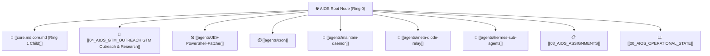

# 🌐 AIOS Root Node (Ring 0 System Core)

> **AIOS Root Architecture**: Primary architectural nucleus providing centralized governance, deterministic agent coordination, and direct bidirectional links across all execution agents, ledger state, and knowledge storage.

**Epoch Synchronization:** `2026-10-27T09:53:57.487287+00:00` · **Architecture:** `Ring-0 AIOS` · **Ledger Status:** `24/58 Jobs Verified`

---

## 1. Direct Agent Wiring (Sub-Agent Roster)

All five active execution agents and daemon services are wired directly to this root node:

| Agent Node | Role | Status | Capabilities | Direct Link |
| :--- | :--- | :--- | :--- | :--- |
| **JEV-PowerShell-Patcher** | `execution_patcher` | `ACTIVE` | Script syntax validation, Windows host patcher, execution bridge | [[agents/JEV-PowerShell-Patcher]] |
| **Cron Orchestrator** | `task_scheduler` | `ACTIVE` | Periodic job runner, anti-drift heartbeat, queue dispatcher | [[agents/cron]] |
| **Maintain Daemon** | `maintenance_daemon` | `ACTIVE` | Lockfile purge, zombie PID cleanup, SQLite vacuum, quota audit | [[agents/maintain-daemon]] |
| **Meta-Diode-Relay** | `metadata_diode` | `ACTIVE` | Zero-PII metadata diode, sanitized events, isolated SMTP TLS relay | [[agents/meta-diode-relay]] |
| **Hermes Sub-Agents** | `local_inference_cluster` | `ACTIVE` | VRAM-locked inference (`keep_alive=-1`), HMAC RPC, schema quarantine | [[agents/hermes-sub-agents]] |

---

## 2. Core Routing & Operational Ledgers

- **Assignment Routing Engine:** [[03_AIOS_ASSIGNMENTS]] *(Direct bridge between Kanban orchestrator, SQLite ledger, and educate)*
- **GTM Outreach & Research Engine:** [[04_AIOS_GTM_OUTREACH]] *(Autonomous B2B pipeline, dedicated client research nodes, Hermes email drafting)*
- **Operational State & Blackboard:** [[00_AIOS_OPERATIONAL_STATE]] *(Thread-safe shared short-term memory & cross-agent blackboard)*
- **Completed Tasks Ledger:** [[01_AIOS_COMPLETED_TASKS_LOG]] *(Monotonic audit log of recent sub-agent executions)*
- **Cross-Agent Blackboard:** [[02_AIOS_CROSS_AGENT_BLACKBOARD]] *(Ephemeral key-value working memory)*
- **Second Brain Base Nucleus (Ring 1 Child):** [[core.md]] *(Taxonomy, module governance, source chronology — demoted to Ring 1 child governed under AIOS Root)*

---

## 3. Live SQLite `job_ledger.db` Metrics

- **Database Path:** `C:\Users\alesh\jev-workspace\delivery-offline\job_ledger.db`
- **Total Ledger Jobs:** `58`
- **Completed:** `24` · **Running:** `0` · **Validated:** `0` · **Approved:** `0` · **Quarantined:** `0`
- **Active Job Types:**
  - `agent_task`: 4 job(s)
  - `architecture_routing_task`: 16 job(s)
  - `chaos_fatal_task`: 12 job(s)
  - `hermes_inference`: 1 job(s)
  - `reconciliation`: 21 job(s)
  - `reconciliation_triage`: 2 job(s)
  - `risk_extraction`: 1 job(s)
  - `sow_discovery_pipeline`: 1 job(s)

### Recent Ledger Audit Entries
| Job ID | Type | State | Scope | Timestamp |
| :--- | :--- | :--- | :--- | :--- |
| `routing-test-1793094827` | `architecture_routing_task` | `[ DONE ]` | `aios-systems-architect` | 2026-10-27T09:53:51 |
| `chaos-fatal-1793094773` | `chaos_fatal_task` | `[ NEEDS_REVIEW ]` | `aios-systems-architect` | 2026-10-27T09:53:00 |
| `routing-test-1793070532` | `architecture_routing_task` | `[ DONE ]` | `aios-systems-architect` | 2026-10-27T03:08:56 |
| `chaos-fatal-1793070480` | `chaos_fatal_task` | `[ NEEDS_REVIEW ]` | `aios-systems-architect` | 2026-10-27T03:08:06 |
| `routing-test-1793068887` | `architecture_routing_task` | `[ DONE ]` | `aios-systems-architect` | 2026-10-27T02:41:31 |

---
*Maintained autonomously by AIOS Obsidian Root Generator.*
