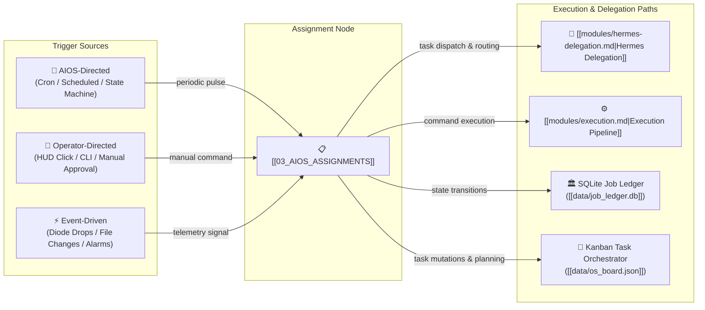

# 📋 AIOS Assignments & Routing Engine (Dynamic Task Dispatcher)

> **Architectural Mission:** The Assignments Node serves as the unified routing nexus connecting high-level task goals to execution agents. It coordinates three explicit trigger sources (**AIOS-directed**, **operator-directed**, and **event-driven**) directly into the Kanban task orchestrator, the SQLite ledger state machine, and Second Brain educational procedures.

- **System Parent:** [[00_AIOS_ROOT]]
- **Operational State Mirror:** [[00_AIOS_OPERATIONAL_STATE]]

---

## 1. Incoming Edge Mapping & Three Trigger Sources

Execution agents map incoming edges to this assignments node according to three strict trigger sources:

### Execution Agent Trigger Routing Matrix

| Execution Agent | Incoming Edge Type | Accepted Trigger Sources | Target Handler / Action |
| :--- | :--- | :--- | :--- |
| **JEV-PowerShell-Patcher** | `patch-dispatch` | `operator-directed`, `aios-directed`, `event-driven` | `execute_task_command('patch')` / Hotfix apply |
| **Cron Orchestrator** | `scheduled-pulse` | `aios-directed` | `trigger_cron_job()`, automated daily planning |
| **Maintain Daemon** | `clean-routine` | `aios-directed`, `operator-directed`, `event-driven` | `job_ledger` stale lock clear, zombie PID reclaim |
| **Meta-Diode-Relay** | `diode-signal` | `event-driven`, `operator-directed` | `metadata_outbox.json` export & SMTP flush |
| **Hermes Sub-Agents** | `inference-handoff` | `operator-directed`, `aios-directed` | `LiveLocalModelAdapter` (`keep_alive=-1`) |
| **Research Agents (GTM)** | `research-eval` | `aios-directed`, `operator-directed`, `event-driven` | `staged_outreach.json` review & Level 4 gate |

---

## 2. Direct Kanban Board Orchestrator Link

- **Live Store:** [`data/os_board.json`](file:///c:/Users/alesh/jev-workspace/hud-interface/data/os_board.json)
- **Board Controller:** `hud.os_dashboard.apply_board_op()` via `POST /api/os/board`
- **Current Revision:** `50` · **Active Workload Items:** `48`

### Active Tasks in Orchestrator
| Task ID | Title | Priority | Vital | Status | Estimate |
| :--- | :--- | :--- | :--- | :--- | :--- |
| `task_496b408ea9` | Review staged outreach drafts in the Outbox | P1 | ⭐ | `todo` | 30m |
| `task_4b74f846b7` | Run the unit test suite after today's changes | P2 | — | `doing` | 15m |
| `task_6086fa4f93` | Gateway integration verification | P1 | ⭐ | `todo` | 30m |
| `task_554fbc4d6d` | Hermes Autonomous Discovery Task | P2 | — | `todo` | 30m |
| `task_54acf084b8` | Gateway integration verification | P1 | ⭐ | `todo` | 30m |
| `task_acfa828685` | Hermes Autonomous Discovery Task | P2 | — | `todo` | 30m |
| `task_04db8c3e8c` | Gateway integration verification | P1 | ⭐ | `todo` | 30m |
| `task_c98206b487` | Hermes Autonomous Discovery Task | P2 | — | `todo` | 30m |

---

## 3. Direct SQLite Ledger State Link

- **Durable Store:** [`data/job_ledger.db`](file:///c:/Users/alesh/jev-workspace/hud-interface/data/job_ledger.db)
- **State Machine Rules:** Strict forward progression (`queued -> running -> validated -> approved -> completed`).
- **Audit Verification:** `24` completed, `0` running, `0` quarantined.
- **Lock Management:** Zero active stale locks; cleared atomically with zero thread starvation.

---

## 4. Direct Specific Educate & Second Brain Knowledge Links

All research and execution agents reference standardized educational procedures and governance constraints before executing assignments:

1. **[[modules/hermes-delegation.md]]:** Team routing, local model execution boundaries, and human-in-the-loop review criteria.
2. **[[modules/execution.md]]:** Tool authorization specifications, dry-run simulations, and Level 6 bash guardrails.
3. **[[modules/knowledge-memory.md]]:** 9-layer storage boundaries, separating runtime state from hot context and durable procedures.
4. **[[modules/source-governance.md]]:** Strict provenance, source conflict resolution, and immutable chronologies.
5. **[[modules/verification.md]]:** Observable proof requirements and Level 8/Level 10 deterministic test contracts.

---
*Maintained autonomously by AIOS Obsidian Root Generator.*
