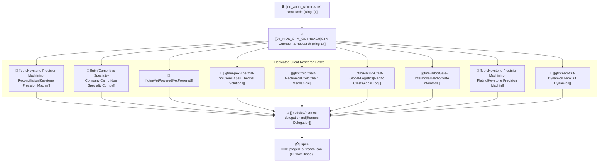

# 🎯 AIOS GTM Outreach & Research Engine (Ring 1 Governance)

> **Architectural Mission:** The GTM Outreach & Research Node operates under strict **AIOS Root Governance** to manage market discovery, targeted B2B client research, Level 4 confidence evaluation, and outbound communications. It anchors standalone prospect nodes and routes execution directly to **Hermes Delegation** for deterministic, evidence-backed personalization.

- **Parent System Nucleus:** [[00_AIOS_ROOT]] *(Ring 0 Core)*
- **Operational State Mirror:** [[00_AIOS_OPERATIONAL_STATE]]
- **Task Assignments Dispatcher:** [[03_AIOS_ASSIGNMENTS]]
- **Outbound Delegation Route:** [[modules/hermes-delegation.md|Hermes Delegation]]

---

## 1. AIOS GTM Governance & Authority

1. **Ring 1 Architectural Child:** Operates as a top-level subsystem under [[00_AIOS_ROOT]], ensuring that all commercial discovery aligns with AIOS execution boundaries.
2. **Zero-PII & Zero-Accidental-Dispatch Policy:** Outbound messages are generated as drafts into `staged_outreach.json` for human review. The engine never connects directly to live SMTP without human cryptographic approval.
3. **Deterministic Financial Grounding:** All value claims are derived from verified ledger invariants, Level 8 CSV audits, and Level 9 SOW specifications.

---

## 2. Dedicated Client Research Bases (Prospect Roster)

All 9 target prospects from `staged_outreach.json` have been mapped into dedicated standalone research nodes:

| Client Target | Prospect ID | Vertical / Sector | Primary Contact | Review Gate | Research File |
| :--- | :--- | :--- | :--- | :--- | :--- |
| **[[gtm/Keystone-Precision-Machining-Reconciliation\|Keystone Precision Machining]]** | `gtm_e2e_keystone_reconciliation` | `Precision CNC / JobBOSS Reconciliation` | Brian Kelling | **PENDING** | [[gtm/Keystone-Precision-Machining-Reconciliation]] |
| **[[gtm/Cambridge-Specialty-Company\|Cambridge Specialty Company]]** | `gtm_001` | `Precision Manufacturing / B2B` | Lead | **APPROVED** | [[gtm/Cambridge-Specialty-Company]] |
| **[[gtm/VetPowered\|VetPowered]]** | `gtm_002` | `Precision Manufacturing / B2B` | Lead | **APPROVED** | [[gtm/VetPowered]] |
| **[[gtm/Apex-Thermal-Solutions\|Apex Thermal Solutions]]** | `gtm_bbbf06f3` | `Commercial Refrigeration/HVAC` | Marcus Vance | **PENDING** | [[gtm/Apex-Thermal-Solutions]] |
| **[[gtm/ColdChain-Mechanical\|ColdChain Mechanical]]** | `gtm_d0db6559` | `Commercial Refrigeration/HVAC` | Elena Rostova | **PENDING** | [[gtm/ColdChain-Mechanical]] |
| **[[gtm/Pacific-Crest-Global-Logistics\|Pacific Crest Global Logistics]]** | `gtm_cae660eb` | `Maritime Freight/NVOCC` | David Sterling | **PENDING** | [[gtm/Pacific-Crest-Global-Logistics]] |
| **[[gtm/HarborGate-Intermodal\|HarborGate Intermodal]]** | `gtm_73909b5d` | `Maritime Freight/NVOCC` | Nadia Chen | **PENDING** | [[gtm/HarborGate-Intermodal]] |
| **[[gtm/Keystone-Precision-Machining-Plating\|Keystone Precision Machining]]** | `gtm_e4ec3886` | `Precision CNC` | Brian Kelling | **PENDING** | [[gtm/Keystone-Precision-Machining-Plating]] |
| **[[gtm/AeroCut-Dynamics\|AeroCut Dynamics]]** | `gtm_33207f88` | `Precision CNC` | Samantha Miller | **PENDING** | [[gtm/AeroCut-Dynamics]] |

---

## 3. Execution Routing: Outbound to Hermes Delegation

When execution triggers occur (AIOS-directed, operator-directed, or diode event), task dispatching flows through the following pipeline:

1. **Context Ingestion:** The Hermes Agent reads the dedicated client research base (e.g., `[[gtm/Cambridge-Specialty-Company]]`) to extract target systems, known discrepancy patterns, and financial exposure.
2. **Inference Execution:** The Hermes Agent invokes the local OpenAI-compatible inference loop (`127.0.0.1:8080`) using `LiveLocalModelAdapter` with `keep_alive=-1` to ensure rapid, in-memory prompt completion.
3. **Pydantic Validation & Gate 4 Evaluation:** The generated draft is validated against `OutreachDraft` schemas, scored via `CompositeScore` (Level 3), and verified against `ConfidenceGate` (Level 4).
4. **Diode Staging:** The finalized draft is staged into `staged_outreach.json` awaiting human authorization.

---

## 4. Key Knowledge & Module References

- **[[modules/hermes-delegation.md]]:** Delegation boundaries, local model execution, and approval handoffs.
- **[[modules/execution.md]]:** Tool authorization specifications and Level 6 bash guardrails.
- **[[modules/source-governance.md]]:** Provenance tracking, conflict resolution, and immutable chronologies.
- **[[modules/verification.md]]:** Observable proof requirements and Level 8/Level 10 deterministic test contracts.

---
*Maintained under AIOS Authority · Connected to [[00_AIOS_ROOT]] and [[modules/hermes-delegation.md]].*
